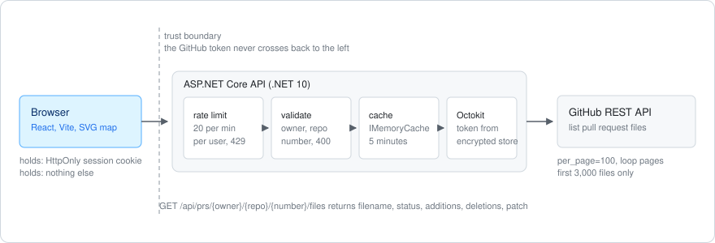
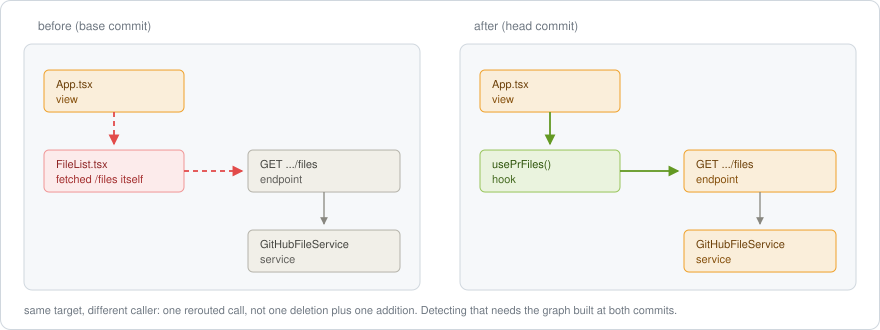
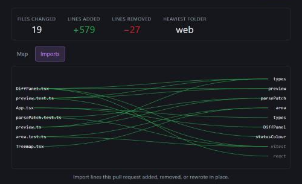

# PRVisualizer

[](https://github.com/azharxkhan/PRVisualizer/actions/workflows/ci.yml)

Paste a GitHub pull request link, get a clickable map of everything that changed.

AI tools write large pull requests quickly, and GitHub presents them as one long flat list of
files. A reviewer's first problem is not reading the diff, it is working out where to start.
PRVisualizer answers that one question: **which parts of this PR carry the most change, and how
do they relate to each other?**

No AI, no summarising, no guessing. Every box and every number comes from GitHub's own API.

**Status: v1 complete, and the first slice of v2 with it.** Paste a pull request link, read any
file's diff beside the map, sign in with GitHub for private repositories, and switch to the List
or Imports tab for a ranked file list or the dependencies the pull request added, removed or
rewrote.

## Try it

**<https://azharxkhan.github.io/PRVisualizer/>** — no install, no sign-up. Paste any public pull
request link and it draws. See [Hosting](#hosting) for what that build can and cannot do.

## Three ways to read a pull request

| Tab | Answers | Read it when |
| --- | --- | --- |
| **Map** | Where is the weight? | You are new to the change and need somewhere to start |
| **List** | What exactly changed? | You want every file, biggest first, with no decoding |
| **Imports** | What now depends on what? | The change moved code between modules |

All three share one palette: green added, amber modified, red removed, violet renamed. Clicking
a file in either the map or the list opens its diff beside it.

The whole page is one screen: the chrome takes the height it needs and the map takes the rest,
so nothing about a pull request is below the fold. Under 620px of window height that would
leave a map too short to read, so the page goes back to scrolling instead.

A file whose box would come out narrower than 20px leaves the map and appears as a labelled
chip under it. An area floor cannot fix that on its own, because the squarify algorithm can
spend the area on a tall thin ribbon that is unreadable and all but unclickable; moving those
files out keeps the rest of the map honest and gives them a hit target you can actually hit.

### The panel reads the file, not just the diff

| File | What the panel offers |
| --- | --- |
| Anything with a patch | The diff, with old and new line numbers, syntax highlighted |
| Any text file | **File**: the whole thing at the head commit, numbered and highlighted — the diff shows hunks only |
| `.md`, `.markdown`, `.mdx` | **Rendered** as well, so a README reads as a README |
| `.png`, `.jpg`, `.gif`, `.webp`, `.svg` | The image itself, on a chequerboard so transparency shows |
| `.pdf`, fonts, archives, video, binaries | Named for what it is, with a link to GitHub |

Syntax colours cover TypeScript, JavaScript, C#, Java, Kotlin, Python, Rust, Go, C, C++,
JSON, YAML, TOML, INI, Bash, SQL, Markdown, HTML/XML (which covers `.csproj` and `.svg`) and
CSS. A file whose extension is not on that list is shown as plain text rather than guessed at.
The **File** view highlights the whole file in one pass, so a block comment or a multi-line
string is coloured as the single token it is; the diff can only highlight line by line, because
the added and removed lines of a patch are not a continuous piece of source.

Rendered markdown comes from a stranger's repository, so it is untrusted input. Raw HTML in the
source is dropped rather than passed through, and link and image URLs must be `http(s)`, which
removes the script and `javascript:` vectors without a sanitiser dependency. Those two rules are
the subject of most of `markdown.test.ts`.

## What we are building

### The map view (Phases 3 and 4)

Every changed file is a box. Box area is how many lines changed, colour is what happened to it,
and boxes are nested inside the folder they live in, so a folder that took heavy change is
visibly a heavy region of the map. Clicking a box opens that file's patch beside the map.


That is dotnet/runtime#100000 with one added file open. Area is lines changed, so the two large
amber boxes are where the work went; the outlined green box is the file whose diff is showing. A
folder holding nothing but one more folder is folded into a single label, so a path like
`staging/src/k8s.io` costs one strip rather than three.

Why a treemap and not a list: a list gives every file the same visual weight, so a 2-line config
tweak looks as important as a 400-line rewrite. Area makes the weight obvious before you read a
single filename.

The List tab is there anyway, because the map's strength is also its weakness. Area answers
"where is the weight" faster than anything else, but a reader who wants the plain facts should
not have to estimate rectangles: the list gives the same files ranked by size, each with its
counts and a bar on one shared scale. Both views feed the same diff panel.

The four numbers along the top are the summary: files changed, lines added, lines removed, and
the folder with the most change.

### How a request flows

The browser never holds a GitHub token. It holds a session cookie and nothing else. The API owns
the token, and every request passes a rate limiter and strict input validation before GitHub is
called at all. Repeat views come from a 5-minute cache rather than spending API quota.



Three rules hold the whole design together:

1. The GitHub token never reaches the browser.
2. Every input is validated before it is used.
3. Every user is rate limited.

Because of rule 1, authentication uses a **GitHub App**, not an OAuth App. An OAuth App needs the
`repo` scope to read private repositories, and that scope grants full read and write access to
every repository the user owns. A GitHub App asks for exactly what this tool needs: pull requests
read-only, contents read-only, metadata read-only.

### Later: how the calls moved (v2)

The map shows which files changed. It cannot show what that change did to the shape of the code.
A separate view compares the call graph at the base commit against the head commit, so a call
that moved reads as a move rather than as an unrelated deletion and addition.



This is deliberately out of scope for v1, because it cannot be built from GitHub's file list.
It needs the source of each changed file parsed at both commits, which means more API calls and a
real parser per language (the TypeScript compiler API for the web side, Roslyn for C#). Earning
it in stages:

- ~~Import edges from the patch text alone.~~ **Built.** An added `import` line is a new edge, a
  removed one is an edge that went away, and a specifier both removed and added reads as a move
  rather than as two opposing arrows. No file fetches and no parser: the patches are already in
  the response the map draws from.



  That is this repository's own #2, where the diff panel moved into `web/src/diff/`.

  Languages read, and how each one decides a specifier is internal rather than a package:

  | Language | Import syntax read | Internal when |
  | --- | --- | --- |
  | TypeScript, JavaScript | `import`, `export … from`, `require()` | the specifier is relative |
  | C# | `using`, `global using`, `using static` | the root namespace is one the PR declares |
  | Java, Kotlin | `import`, `import static` | the root package is one the PR declares |
  | Python | `import a.b`, `from a.b import x` | the specifier is relative (`.models`) |
  | Rust | `use`, `pub use`, `extern crate` | it starts with `crate`, `super` or `self` |
  | Go | `import "x"`, and the lines of an `import ( … )` block | never: Go has no relative imports |
  | C, C++ | `#include "x"` and `#include <x>` | the include is quoted, not angled |

  The internal test is always something the patch itself carries. That is why Go has none: its
  imports are all absolute, and deciding would need the module name from `go.mod`, which a
  patch does not supply. For the same reason a Python `import mypackage.thing` counts as
  external, because nothing in the diff separates the project's own top-level package from one
  in site-packages.
- Call edges inside a module. Needs full file contents and an AST walk, so it gets capped by file
  size, language and count.
- Movement detection. Build the edge set at both commits and compare: same target with a
  different caller is a reroute.

## Build phases

| Phase | What | Done when |
| --- | --- | --- |
| 0 | Skeleton: repo, API, web app, CI | `GET /api/health` returns 200 and the page shows "API ok" |
| 1 | Fetch one public PR's files via Octokit | A public PR's files show as raw JSON |
| 2 | Input validation and rate limiting | Bad input returns 400, the 21st request in a minute returns 429 |
| 3 | The map | A 50-file PR renders as a readable map with folder labels |
| 4 | Diff panel | Clicking any box shows its diff, or a clear "too big to preview" |
| 5 | Sign in and private repos | A PR from a private repo renders, and no token appears in dev tools |
| 6 | Public hosting | The Pages build maps a public PR with no server running |

All five phases are done, and the first of the three v2 stages with them. Next is the second:
call edges inside a module, which needs full file contents and an AST walk, capped by file size,
language and count.

## Known limits

GitHub's "list pull request files" endpoint shapes most of these.

| Case | What the tool shows |
| --- | --- |
| More than 3,000 files | Banner: showing 3,000 of N files |
| No patch, no line changes | Box renders at a minimum size, panel says no preview available |
| No patch, but lines changed | "Too big to preview", with a link to GitHub |
| Renamed file | Box in the renamed colour, old and new name both shown in the panel |
| Box too small to click | The file moves to the chip strip under the map |
| Image file | The image itself, from `raw.githubusercontent.com` |
| Removed file | No rendered or image view: there are no contents at the head commit |
| Markdown in a private repo | The rendered view needs the raw file to be reachable; the diff still works |
| PR not found or no access | "That pull request could not be found. It may be private, or the link may be wrong." |
| GitHub rate limit hit | "GitHub is busy, try again in a minute" |

A missing `patch` cannot be read as "binary". GitHub omits it both for oversized diffs and for
files it declines to diff at all, and the response carries nothing that separates the two. The
rows above split on the only signal available: whether any lines changed.

## Run locally

Needs the .NET 10 SDK and a current Node LTS.

Backend:

```bash
dotnet run --project api/PrMap.Api --launch-profile https
```

`--launch-profile https` matters: the default `http` profile never opens the HTTPS port the web
app proxies to. Run `dotnet dev-certs https --trust` once if the browser rejects the certificate.

Frontend, in a second terminal:

```bash
cd web
npm install
npm run dev
```

Open the Vite URL. The dev server proxies `/api` to the API's HTTPS port, so there are no CORS
rules to configure. If the API's port differs from the one in `web/vite.config.ts`, take the
correct one from `api/PrMap.Api/Properties/launchSettings.json`.

Public pull requests work as-is. Without a token GitHub allows 60 requests an hour per IP, and
one 3,000-file pull request spends 30 of them, so for heavy use set an instance token:

```bash
dotnet user-secrets --project api/PrMap.Api set "GitHub:InstanceToken" "<token>"
```

### Signing in, for private repositories

Register a GitHub App at <https://github.com/settings/apps/new>:

| Field | Value |
| --- | --- |
| Callback URL | `http://localhost:5173/api/auth/callback` |
| Webhook → Active | unchecked |
| Request user authorization (OAuth) during installation | checked |
| Permissions | Pull requests, Contents and Metadata, all **Read-only** |

A GitHub App rather than an OAuth App because an OAuth App would need the `repo` scope, which
grants read *and write* to every repository you own. Generate a client secret, then:

```bash
dotnet user-secrets --project api/PrMap.Api set "GitHub:ClientId" "<client id>"
```

```bash
dotnet user-secrets --project api/PrMap.Api set "GitHub:ClientSecret" "<client secret>"
```

```bash
dotnet user-secrets --project api/PrMap.Api set "GitHub:AuthMode" "GitHubApp"
```

Restart the API and the header shows "Sign in with GitHub". The browser gets an opaque,
HttpOnly session cookie; the token itself stays on the server, encrypted with Data Protection,
and is refreshed in the background when GitHub's eight-hour expiry comes round. Signing out, or
restarting the API, ends the session.

## Hosting

GitHub Pages serves files. It cannot run the .NET API, so the deployed site is a **static
build** that skips the API and calls `api.github.com` from the browser instead. GitHub's REST
API sends CORS headers, so this works; what changes is who holds the token.

| | Full build (`npm run dev`) | Static build (GitHub Pages) |
| --- | --- | --- |
| Who calls GitHub | The .NET API | The browser |
| Who holds the token | The server, in an encrypted session | Nobody, or the user's own token in `localStorage` |
| Private repositories | Sign in with the GitHub App | Only with a token you paste |
| Anonymous rate limit | 60/hour per **server** IP, plus a 5-minute cache | 60/hour per **visitor** IP |
| Rate limiting and validation | Server-side, enforced | Client-side only |

The three rules above still hold where they can: the static build has no server to leak a token
from, and the token a user pastes is theirs, kept in their own browser and sent only to
`api.github.com`. What it loses is the server-side cache and rate limiter, and the GitHub App's
read-only scoping — a pasted personal access token is as narrow as the user makes it, so the
hint in the app links to the fine-grained token page.

**If you want the full build hosted**, Pages is the wrong host: run the API somewhere that runs
containers (Azure Container Apps, Fly.io, Render) and point the frontend at it. The split is
worth keeping either way, because a static Pages build is the version that costs nothing and
needs no secrets.

### Turning Pages on

`.github/workflows/pages.yml` builds and deploys on every push to `main`. It needs Pages
switched on once, by hand:

**Settings → Pages → Build and deployment → Source: GitHub Actions.**

That is the only manual step. The workflow sets `VITE_STATIC=true` so the browser transport is
used, and `BASE_PATH=/<repo>/` so a project site's asset URLs resolve. To build it locally:

```bash
cd web && VITE_STATIC=true BASE_PATH=/PRVisualizer/ npm run build
```

## Layout

```text
api/
  PrMap.Api/          .NET 10 Web API, owns the GitHub token
  PrMap.Api.Tests/    xUnit tests
web/                  React + TypeScript (Vite)
  src/api/mode.ts     picks the API or the browser-direct transport
docs/                 diagrams used in this README
.github/workflows/    ci.yml builds and tests both halves; pages.yml deploys the static build
```

## Stack

| Layer | Choice | Why |
| --- | --- | --- |
| Backend | .NET 10 Web API (C#) | Holds the token, calls GitHub, shapes the data |
| GitHub client | Octokit | Typed calls instead of hand-written HTTP |
| Rate limiting | `Microsoft.AspNetCore.RateLimiting` | Built in, no extra package |
| Cache | `IMemoryCache` | Saves API quota on repeat views |
| Frontend | React + TypeScript via Vite | Fast dev server |
| Map layout | `d3-hierarchy` (`treemap`) | Does the box packing; the SVG is drawn by hand |
| Markdown | `marked` | Renders the markdown view; raw HTML is dropped, not sanitised after the fact |
| Syntax colours | `prismjs` | 20 grammars, loaded explicitly; the palette is this app's own, not a Prism theme |
| Diff view | Own component | GitHub sends a patch as plain text; rendering it avoids a heavy dependency |

.NET 10 rather than 8: .NET 8 loses security support in November 2026, and .NET 10 is supported
to November 2028.

## Secrets

Local development uses `dotnet user-secrets`, which stores values outside the repository:

```bash
dotnet user-secrets init --project api/PrMap.Api
dotnet user-secrets set "GitHub:ClientId" "<client-id>" --project api/PrMap.Api
dotnet user-secrets set "GitHub:ClientSecret" "<client-secret>" --project api/PrMap.Api
```

Read them with `builder.Configuration["GitHub:ClientId"]`. Never in `appsettings.json`, never in a
commit. In production these come from environment variables or a secrets manager. The user's
GitHub token is encrypted with ASP.NET Core Data Protection and stays server-side.
