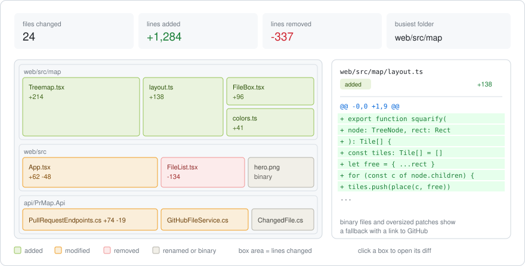
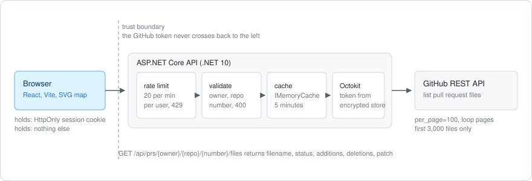
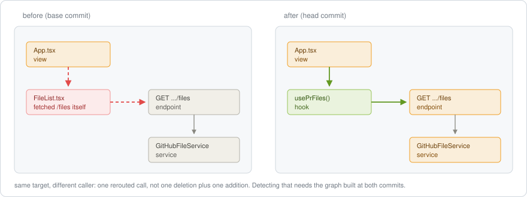

# PRVisualizer

[](https://github.com/azharxkhan/PRVisualizer/actions/workflows/ci.yml)

Paste a GitHub pull request link, get a clickable map of everything that changed.

AI tools write large pull requests quickly, and GitHub presents them as one long flat list of
files. A reviewer's first problem is not reading the diff, it is working out where to start.
PRVisualizer answers that one question: **which parts of this PR carry the most change, and how
do they relate to each other?**

No AI, no summarising, no guessing. Every box and every number comes from GitHub's own API.

**Status: Phase 0 complete.** The skeleton runs and CI is green. The views below are the design
being built toward, drawn as diagrams rather than screenshots. They will be replaced with real
screenshots as each phase lands.

## What we are building

### The map view (Phases 3 and 4)

Every changed file is a box. Box area is how many lines changed, colour is what happened to it,
and boxes are nested inside the folder they live in, so a folder that took heavy change is
visibly a heavy region of the map. Clicking a box opens that file's patch beside the map.



Why a treemap and not a list: a list gives every file the same visual weight, so a 2-line config
tweak looks as important as a 400-line rewrite. Area makes the weight obvious before you read a
single filename.

The four numbers along the top are the summary: files changed, lines added, lines removed, and
the folder with the most change.

### How a request flows

The browser never holds a GitHub token. It holds a session cookie and nothing else. The API owns
the token, and every request passes a rate limiter and strict input validation before GitHub is
called at all. Repeat views come from a 5-minute cache rather than spending API quota.



Three rules hold the whole design together:

1. The GitHub token never reaches the browser.
2. Every input is validated before it is used.
3. Every user is rate limited.

Because of rule 1, authentication uses a **GitHub App**, not an OAuth App. An OAuth App needs the
`repo` scope to read private repositories, and that scope grants full read and write access to
every repository the user owns. A GitHub App asks for exactly what this tool needs: pull requests
read-only, contents read-only, metadata read-only.

### Later: how the calls moved (v2)

The map shows which files changed. It cannot show what that change did to the shape of the code.
A separate view compares the call graph at the base commit against the head commit, so a call
that moved reads as a move rather than as an unrelated deletion and addition.



This is deliberately out of scope for v1, because it cannot be built from GitHub's file list.
It needs the source of each changed file parsed at both commits, which means more API calls and a
real parser per language (the TypeScript compiler API for the web side, Roslyn for C#). Earning
it in stages:

- Import edges from the patch text alone. An added `import` line is a new edge, a removed one is a
  gone edge. No file fetches, no parser, and it draws most of the module-level arrows.
- Call edges inside a module. Needs full file contents and an AST walk, so it gets capped by file
  size, language and count.
- Movement detection. Build the edge set at both commits and compare: same target with a
  different caller is a reroute.

## Build phases

| Phase | What | Done when |
| --- | --- | --- |
| 0 | Skeleton: repo, API, web app, CI | `GET /api/health` returns 200 and the page shows "API ok" |
| 1 | Fetch one public PR's files via Octokit | A public PR's files show as raw JSON |
| 2 | Input validation and rate limiting | Bad input returns 400, the 21st request in a minute returns 429 |
| 3 | The map | A 50-file PR renders as a readable map with folder labels |
| 4 | Diff panel | Clicking any box shows its diff, or a clear "too big to preview" |
| 5 | Sign in and private repos | A PR from a private repo renders, and no token appears in dev tools |

Phase 0 is done. Phase 1 is next.

## Known limits

GitHub's "list pull request files" endpoint shapes most of these.

| Case | What the tool shows |
| --- | --- |
| More than 3,000 files | Banner: showing 3,000 of N files |
| Binary file (image, PDF) | Box renders, diff panel says binary file |
| Patch too large to return | Fallback with a link to the file on GitHub |
| Renamed file | Neutral box, old and new name both shown |
| PR not found or no access | A friendly message, never the raw error |
| GitHub rate limit hit | "GitHub is busy, try again in a minute" |

## Run locally

Needs the .NET 10 SDK and a current Node LTS.

Backend:

```bash
dotnet run --project api/PrMap.Api --launch-profile https
```

`--launch-profile https` matters: the default `http` profile never opens the HTTPS port the web
app proxies to. Run `dotnet dev-certs https --trust` once if the browser rejects the certificate.

Frontend, in a second terminal:

```bash
cd web
npm install
npm run dev
```

Open the Vite URL. The page should show "API ok". The dev server proxies `/api` to the API's HTTPS
port, so there are no CORS rules to configure. If the API's port differs from the one in
`web/vite.config.ts`, take the correct one from `api/PrMap.Api/Properties/launchSettings.json`.

## Layout

```text
api/
  PrMap.Api/          .NET 10 Web API, owns the GitHub token
  PrMap.Api.Tests/    xUnit tests
web/                  React + TypeScript (Vite)
docs/                 diagrams used in this README
.github/workflows/    CI: builds and tests both halves
```

## Stack

| Layer | Choice | Why |
| --- | --- | --- |
| Backend | .NET 10 Web API (C#) | Holds the token, calls GitHub, shapes the data |
| GitHub client | Octokit | Typed calls instead of hand-written HTTP |
| Rate limiting | `Microsoft.AspNetCore.RateLimiting` | Built in, no extra package |
| Cache | `IMemoryCache` | Saves API quota on repeat views |
| Frontend | React + TypeScript via Vite | Fast dev server |
| Map layout | `d3-hierarchy` (`treemap`) | Does the box packing; the SVG is drawn by hand |
| Diff view | Own component | GitHub sends a patch as plain text; rendering it avoids a heavy dependency |

.NET 10 rather than 8: .NET 8 loses security support in November 2026, and .NET 10 is supported
to November 2028.

## Secrets

Local development uses `dotnet user-secrets`, which stores values outside the repository:

```bash
dotnet user-secrets init --project api/PrMap.Api
dotnet user-secrets set "GitHub:ClientId" "<client-id>" --project api/PrMap.Api
dotnet user-secrets set "GitHub:ClientSecret" "<client-secret>" --project api/PrMap.Api
```

Read them with `builder.Configuration["GitHub:ClientId"]`. Never in `appsettings.json`, never in a
commit. In production these come from environment variables or a secrets manager. The user's
GitHub token is encrypted with ASP.NET Core Data Protection and stays server-side.
